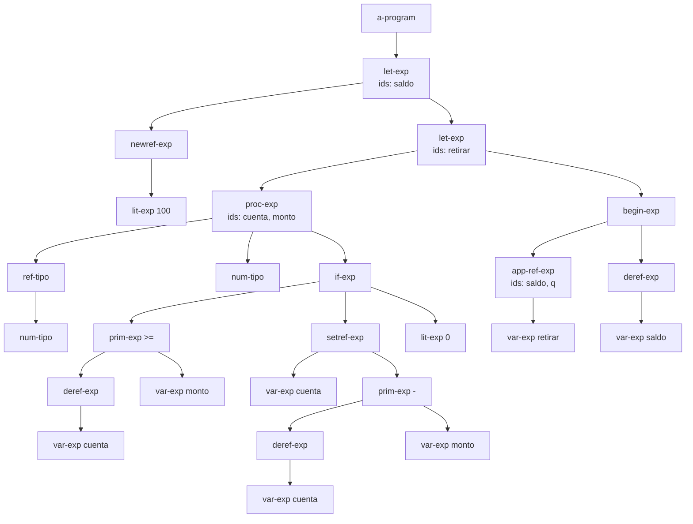
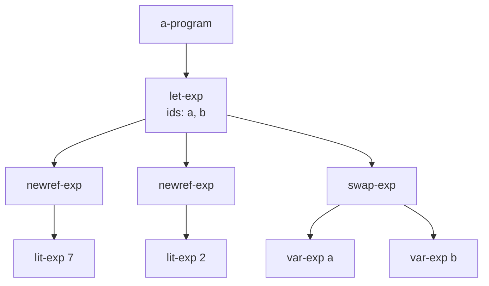
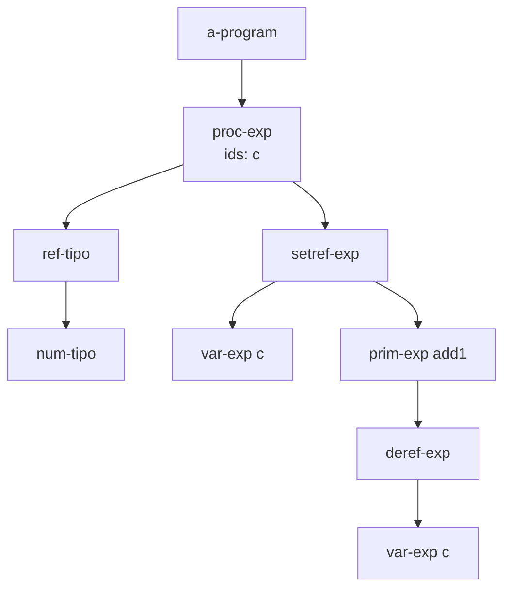
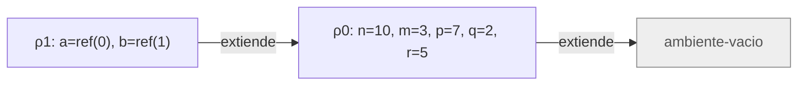
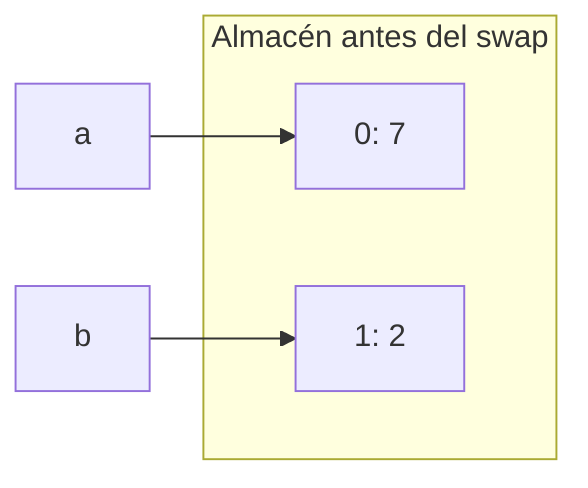
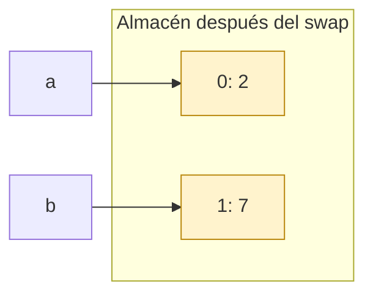

# Informe de AST — Taller 3: Memoria y disciplina

**Curso:** Fundamentos de Interpretación y Compilación de Lenguajes
de Programación — Universidad del Valle, Sede Tuluá.

**Integrantes del grupo:**

| Nombre | Código | Correo institucional |
|--------|--------|----------------------|
| Juan Felipe Aristizabal | 2459364-3743 | juan.felipe.aristizabal@correounivalle.edu.co |
| Juan Sebastian Huertas | 2459505-3743 | huertas.juan@correounivalle.edu.co |

---

## 1. Gramática considerada

La gramática de Cauca con referencias y tipos, tal como la declara
`src/sintaxis.rkt`. Cada alternativa lleva el nombre del constructor
que genera SLLGEN y, entre paréntesis, sus campos.

```bnf
<programa>  ::= <expresion>
                a-program(exp)

<expresion> ::= <numero>
                lit-exp(dato)
            ::= <identificador>
                var-exp(id)
            ::= true
                true-exp()
            ::= false
                false-exp()
            ::= <primitiva> ( {<expresion>}*(,) )
                prim-exp(prim, rands)
            ::= if <expresion> then <expresion> else <expresion> end
                if-exp(test, true-exp, false-exp)
            ::= let {<identificador> = <expresion>}* in <expresion> end
                let-exp(ids, rands, body)
            ::= proc ( {<identificador> : <tipo>}*(,) ) <expresion> end
                proc-exp(ids, tipos, body)
            ::= apply <expresion> ( {<expresion>}*(,) )
                app-exp(rator, rands)
            ::= letrec {<tipo> <identificador> ( {<identificador> : <tipo>}*(,) ) = <expresion>}*
                in <expresion> end
                letrec-exp(tipos-res, proc-names, idss, tipos-args, bodies, body)
            ::= case <expresion> {of <numero> => <expresion>}* otherwise => <expresion> end
                case-exp(exp, valores, acciones, default)
            ::= newref ( <expresion> )
                newref-exp(exp)
            ::= deref ( <expresion> )
                deref-exp(exp)
            ::= setref ( <expresion> , <expresion> )
                setref-exp(ref-exp, val-exp)
            ::= swap ( <expresion> , <expresion> )
                swap-exp(exp1, exp2)
            ::= begin <expresion> {; <expresion>}* end
                begin-exp(exp, exps)
            ::= applyref <expresion> ( {<identificador>}*(,) )
                app-ref-exp(rator, ids)

<tipo>      ::= num
                num-tipo()
            ::= bool
                bool-tipo()
            ::= refto ( <tipo> )
                ref-tipo(tipo)
            ::= ( {<tipo>}*(*) -> <tipo> )
                proc-tipo(args, res)

<primitiva> ::= + | - | * | / | add1 | sub1 | > | >= | < | <= | == | not
              | and | or | abs | mcd | mcm | promedio | xor | implica | entre
```

Dos detalles que se usan más abajo: en `proc-exp` los tipos son las
anotaciones de los parámetros, en el mismo orden que `ids`; y en
`letrec-exp` el tipo que antecede al nombre es el del resultado del
procedimiento, de modo que `tipos-res`, `proc-names`, `idss`,
`tipos-args` y `bodies` son listas paralelas. El `applyref` recibe
**identificadores** y no expresiones: es lo que le permite pasar la
celda de la variable en vez de una copia.

---

## 2. Ejemplos de AST

### Ejemplo 1 — Programa `saldo` / `retirar` (4.1)

**Expresión concreta:**

```scheme
let saldo = newref(100)
in let retirar = proc (cuenta : refto(num), monto : num)
                   if >=(deref(cuenta), monto)
                   then setref(cuenta, -(deref(cuenta), monto))
                   else 0
                   end
                 end
   in begin
        applyref retirar (saldo, q);
        deref(saldo)
      end
   end
end
```

**AST:**



**Explicación:** el `let` de afuera liga `saldo` a `newref(100)`; su
cuerpo es otro `let` que liga `retirar` a un `proc-exp`. El `proc-exp`
tiene dos hijos de tipo, uno por parámetro: `ref-tipo` con `num-tipo`
adentro para `cuenta`, y `num-tipo` para `monto`. Su cuerpo es un
`if-exp` con tres hijos: la condición `>=(deref(cuenta), monto)`, la
rama `then` con el `setref-exp` que escribe `-(deref(cuenta), monto)`
y la rama `else` con `lit-exp 0`. El cuerpo del `let` interior es un
`begin-exp` con dos expresiones: el `app-ref-exp` con operador
`retirar` y los identificadores `saldo` y `q` (no son nodos
`var-exp`: el constructor guarda los símbolos), y el `deref-exp` final.
Este árbol es el que entrega `(parser "...")` con el texto de arriba;
se puede comparar con `(parser texto)` en el REPL.

**Por qué no pasa el chequeador.** `applyref` exige que cada argumento
sea una variable de tipo $\text{refto}(t)$, y `q` está declarada como
`num` en `tenv-inicial`. El chequeador responde:

```text
applyref exige variables de tipo refto(t): q es num
```

El intérprete también lo rechaza, porque `buscar-referencias` encuentra
que `q` está ligada al número 2 y no a una referencia.

**Corrección mínima.** El parámetro pasa a ser `monto : refto(num)`,
cada uso de `monto` pasa a ser `deref(monto)`, y se le entrega una celda
con `let mq = newref(q) in ... applyref retirar (saldo, mq)`:

```scheme
let saldo = newref(100)
in let retirar = proc (cuenta : refto(num), monto : refto(num))
                   if >=(deref(cuenta), deref(monto))
                   then setref(cuenta, -(deref(cuenta), deref(monto)))
                   else 0
                   end
                 end
   in let mq = newref(q)
      in begin
           applyref retirar (saldo, mq);
           deref(saldo)
         end
      end
   end
end
```

Así el chequeador responde `num` y el intérprete da $100 - 2 = 98$.

**Una alternativa que no sirve.** Dejar `monto : num` y cambiar
`applyref` por `apply retirar (saldo, q)` también tipa, pero da 100:
`apply` pasa por valor y `copia-por-valor` le entrega al procedimiento
una celda nueva con el contenido de `saldo`, así que el retiro se hace
sobre la copia y `saldo` queda intacto. Por eso no corrige el problema:
quita el error de tipos, pero no logra que el procedimiento escriba en
la celda del que llama.

---

### Ejemplo 2 — `swap` dentro de un `let`

**Expresión concreta:**

```scheme
let a = newref(7) b = newref(2)
in swap(a, b)
end
```

**AST:**



**Explicación:** el `let-exp` tiene dos ligaduras, cuyas expresiones son
los dos `newref-exp`, y un cuerpo que es el `swap-exp`. Las dos
subexpresiones del `swap-exp` son `var-exp`, que en tiempo de ejecución
resuelven a las referencias de `a` y `b`. El chequeador le asigna el
tipo `num`, porque las dos celdas son $\text{refto}(\text{num})$.

---

### Ejemplo 3 — `proc` con un parámetro de tipo `refto(num)`

**Expresión concreta:**

```scheme
proc (c : refto(num)) setref(c, add1(deref(c))) end
```

**AST:**



**Explicación:** el `proc-exp` lleva un solo hijo de tipo, `ref-tipo`
con `num-tipo` adentro, y como cuerpo el `setref-exp`. El primer hijo
del `setref-exp` es la celda `c` y el segundo es el valor nuevo,
`add1(deref(c))`. El chequeador le asigna `(refto(num) -> num)`: el
procedimiento recibe una celda de números y retorna `num`, que es lo
que da `setref`.

---

## 3. Traza de evaluación

**Expresión a evaluar:**

```scheme
let a = newref(7) b = newref(2)
in begin
     swap(a, b);
     +(deref(a), *(10, deref(b)))
   end
end
```

**Ambiente inicial:** $\rho_0 = [\,n = 10,\ m = 3,\ p = 7,\ q = 2,\ r = 5\,]$, con
el almacén vacío $\sigma_0 = [\,]$.

El ambiente del `let` es $\rho_1 = [\,a = \text{ref}(0),\ b = \text{ref}(1)\,]$,
que extiende a $\rho_0$.

| Expresión | Ambiente | Almacén | Valor |
|-----------|----------|---------|-------|
| `newref(7)` | $\rho_0$ | $[\,]$ → $[0 \mapsto 7]$ | $\text{ref}(0)$ |
| `newref(2)` | $\rho_0$ | $[0 \mapsto 7]$ → $[0 \mapsto 7,\ 1 \mapsto 2]$ | $\text{ref}(1)$ |
| `swap(a, b)` | $\rho_1$ | $[0 \mapsto 7,\ 1 \mapsto 2]$ → $[0 \mapsto 2,\ 1 \mapsto 7]$ | $2$ |
| `deref(a)` | $\rho_1$ | $[0 \mapsto 2,\ 1 \mapsto 7]$ | $2$ |
| `deref(b)` | $\rho_1$ | $[0 \mapsto 2,\ 1 \mapsto 7]$ | $7$ |
| `*(10, deref(b))` | $\rho_1$ | $[0 \mapsto 2,\ 1 \mapsto 7]$ | $70$ |
| `+(deref(a), *(10, deref(b)))` | $\rho_1$ | $[0 \mapsto 2,\ 1 \mapsto 7]$ | $72$ |
| `begin ... end` (el `let` completo) | $\rho_0$ | $[0 \mapsto 2,\ 1 \mapsto 7]$ | $72$ |

El valor de `swap(a, b)` es el contenido que tenía la segunda celda,
$\sigma(\ell_2) = 2$; el `begin` descarta ese valor y retorna el de la
última expresión.

**Diagrama de la cadena de ambientes:**



---

## 4. Estado del almacén antes y después del `swap`

El lenguaje no tiene bloques transaccionales; lo que sí cambia con una
operación es el contenido de las celdas. Este ejemplo muestra el almacén
del programa de la sección 3 justo antes y justo después de
`swap(a, b)`. Las referencias de `a` y `b` no cambian: lo que cambia es
lo que hay en cada celda.

**Programa:**

```scheme
let a = newref(7) b = newref(2)
in begin
     swap(a, b);
     +(deref(a), *(10, deref(b)))
   end
end
```

**Antes del `swap`:**



**Después del `swap`:**



**Explicación:** antes del `swap`, `a` apunta a la celda 0, que guarda 7,
y `b` a la celda 1, que guarda 2. `swap` lee las dos celdas y escribe
cada valor en la otra celda, así que el almacén pasa de
$[0 \mapsto 7,\ 1 \mapsto 2]$ a $[0 \mapsto 2,\ 1 \mapsto 7]$. `a` sigue
apuntando a la celda 0 y `b` a la 1: por eso `deref(a)` da ahora 2 y
`deref(b)` da 7, y la suma final es $2 + 10 \cdot 7 = 72$. No se creó
ninguna celda ni se perdió ninguna: el tamaño del almacén es 2 antes y
después, como pide la condición 2 del invariante.

---

## 5. Referencias

- Friedman, D. P., & Wand, M. *Essentials of Programming Languages*,
  3.ª ed., MIT Press, 2008. Secciones 4.2 (almacén y referencias
  explícitas) y 4.3 (paso por referencia).
- Pierce, B. C. *Types and Programming Languages*, MIT Press, 2002.
  Capítulo 13 (referencias).