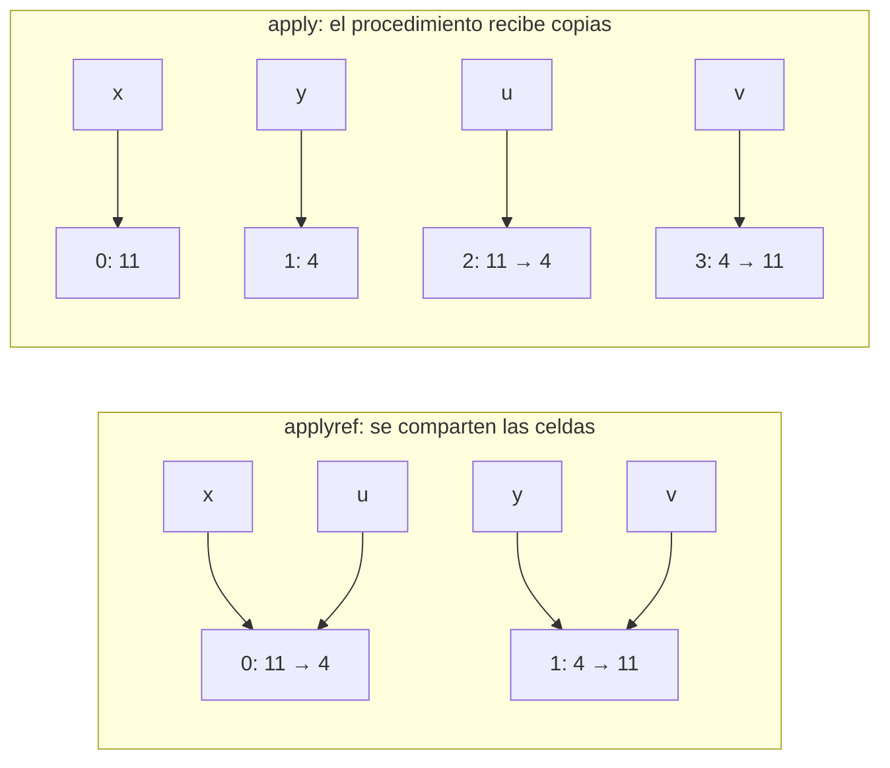

# Informe de corrección — Taller 3: Memoria y disciplina

**Curso:** Fundamentos de Interpretación y Compilación de Lenguajes
de Programación — Universidad del Valle, Sede Tuluá.

**Integrantes del grupo:**

| Nombre | Código | Correo institucional |
|--------|--------|----------------------|
| Juan Felipe Aristizabal | 2459364-3743 | juan.felipe.aristizabal@correounivalle.edu.co |
| Juan Sebastian Huertas | 2459505-3743 | huertas.juan@correounivalle.edu.co |

---

## 1. Marco formal

### 1.1 Corrección de programas recursivos

Sea $f : A \to B$ una función y $A$ un conjunto definido
recursivamente. Sea $P_f$ un programa recursivo en Racket que
pretende calcular $f$. Decimos que $P_f$ es correcto con respecto a
su especificación si se cumple:

$$
\forall a \in A \,:\, P_f(a) = f(a)
$$

La estrategia de demostración es la **inducción estructural**
sobre $A$:

- **Caso base:** para cada valor básico $a_0 \in A$ se verifica
  $P_f(a_0) = f(a_0)$.
- **Caso inductivo:** asumiendo la **hipótesis de inducción**
  $P_f(a') = f(a')$ para las subestructuras $a'$ que forman $a$, se
  demuestra $P_f(a) = f(a)$.

### 1.2 Corrección de programas iterativos

Para un programa iterativo se formalizan:

- Un estado $s$ con componentes relevantes.
- Un estado inicial $s_0$.
- Un estado final reconocido por un predicado $\text{es-final?}(s)$.
- Una **invariante** $\text{Inv}(s)$ que se mantiene entre pasos.
- Una transformación $\text{transformar}(s)$.

La corrección se argumenta demostrando:

1. $\text{Inv}(s_0)$ se cumple al inicio.
2. $\text{Inv}(s) \,\land\, \lnot\text{es-final?}(s)\Rightarrow
   \text{Inv}(\text{transformar}(s))$.
3. $\text{Inv}(s) \,\land\, \text{es-final?}(s)\Rightarrow
   \text{respuesta}(s) = f(\text{entrada})$.
4. El proceso termina (argumentar una función de cota estrictamente
   decreciente sobre $\mathbb{N}$).

### 1.3 Modelo del almacén

En `src/almacen.rkt` el almacén es la lista `the-store`. La
modelamos como una secuencia finita $\sigma = [v_0, v_1, \ldots, v_{k-1}]$
con longitud $|\sigma| = k$, y escribimos $\sigma(\ell)$ para el
elemento de la posición $\ell$, definido solo cuando
$0 \le \ell < |\sigma|$.

Una referencia es `(a-ref ℓ)`; en el informe la identificamos con
su posición $\ell$. Como `referencia` es un `define-datatype` y Cauca
no tiene ninguna expresión que construya una `a-ref` a partir de un
número, **la única forma de obtener una referencia es `newref!`**.
Sea $R$ el conjunto de posiciones que `newref!` ha entregado desde el
último `initialize-store!`. Toda referencia que aparece en un
programa en ejecución pertenece a $R$.

Notación: $\sigma[\ell \mapsto v]$ es el almacén igual a $\sigma$
salvo en la posición $\ell$, que vale $v$.

---

## 2. Funciones analizadas

### 2.1 El almacén preserva su invariante (sección 5.1)

**Especificación.** Las cuatro condiciones del enunciado se dividen
en una propiedad del estado $(\sigma, R)$ y tres propiedades de las
operaciones:

$$
\text{Inv}(\sigma, R) \;\equiv\; \forall \ell \in R \,:\; 0 \le \ell < |\sigma|
\qquad \text{(condición 1)}
$$

- **Condición 2 (solo crece por `newref!`):** si una operación pasa
  de $\sigma$ a $\sigma'$ y $|\sigma'| \ne |\sigma|$, la operación es
  `newref!`, y en ese caso $|\sigma'| = |\sigma| + 1$.
- **Condición 3 (`setref!` toca una sola celda):** si
  $\sigma' = \text{setref!}(\sigma, \ell, v)$, entonces
  $\sigma'(\ell) = v$ y $\sigma'(\ell') = \sigma(\ell')$ para todo
  $\ell' \ne \ell$. Es decir, $\sigma' = \sigma[\ell \mapsto v]$.
- **Condición 4 (rango):** si $\ell < 0$ o $\ell \ge |\sigma|$,
  entonces $\text{deref}(\sigma, \ell)$ levanta `eopl:error`.

Lo que hay que demostrar: $\text{Inv}$ vale al inicio, cada
operación la preserva y cada operación cumple las condiciones 2 a 4.

**Código.**

```racket
;; newref! : valor -> referencia
(define newref!
  (lambda (val)
    (let ((pos (length the-store)))
      (set! the-store (append the-store (list val)))
      (a-ref pos))))

;; deref : referencia -> valor
(define deref
  (lambda (ref)
    (let ((pos (ref->pos ref)))
      (if (posicion-valida? pos)
          (list-ref the-store pos)
          (eopl:error 'deref "referencia fuera de rango: ~s" pos)))))

;; reemplazar : lista x int x valor -> lista
(define reemplazar
  (lambda (lst i val)
    (if (zero? i)
        (cons val (cdr lst))
        (cons (car lst) (reemplazar (cdr lst) (- i 1) val)))))

;; setref! : referencia x valor -> void
(define setref!
  (lambda (ref val)
    (let ((pos (ref->pos ref)))
      (if (posicion-valida? pos)
          (set! the-store (reemplazar the-store pos val))
          (eopl:error 'setref! "referencia fuera de rango: ~s" pos)))))
```

`posicion-valida?` es exactamente $0 \le \ell < |\sigma|$.

**Estrategia de demostración:** el almacén se trata como el estado de
un programa iterativo (sección 1.2). Cada operación es un paso, y se
demuestra que el paso preserva $\text{Inv}$. Para `setref!` se usa
además un lema por inducción sobre la posición.

**Demostración.**

- **Estado inicial.** `initialize-store!` deja
  $\sigma_0 = [\,]$ y $R_0 = \varnothing$. $\text{Inv}(\sigma_0, R_0)$
  se cumple trivialmente, porque no hay ningún $\ell \in R_0$.

- **`newref!(v)`.** Supongamos $\text{Inv}(\sigma, R)$. La función
  calcula $\ell = |\sigma|$ y deja $\sigma' = \sigma \mathbin{+\!\!+} [v]$.
  Entonces:
  - $|\sigma'| = |\sigma| + 1$, lo que cumple la condición 2.
  - Para $i < |\sigma|$, $\sigma'(i) = \sigma(i)$, porque `append`
    conserva el prefijo. Las celdas existentes no cambian.
  - $\sigma'(\ell) = v$, y la referencia entregada cumple
    $0 \le \ell = |\sigma| < |\sigma| + 1 = |\sigma'|$: es válida.
  - El nuevo conjunto es $R' = R \cup \{\ell\}$. Para
    $\ell' \in R$, por hipótesis $\ell' < |\sigma| < |\sigma'|$; para
    $\ell$ ya se vio. Luego $\text{Inv}(\sigma', R')$.

- **Lema (de `reemplazar`).** Para toda lista $l$ y todo
  $0 \le i < |l|$, si $l' = \text{reemplazar}(l, i, v)$ entonces
  $|l'| = |l|$, $l'(i) = v$ y $l'(j) = l(j)$ para todo $j \ne i$.

  Por inducción sobre $i$:
  - **Caso base** ($i = 0$): $l' = \text{cons}(v, \text{cdr}(l))$.
    Tiene la misma longitud, $l'(0) = v$, y para $j > 0$,
    $l'(j) = \text{cdr}(l)(j-1) = l(j)$.
  - **Caso inductivo** ($i > 0$): como $i < |l|$, la lista no es
    vacía y $i - 1 < |\text{cdr}(l)|$. Por hipótesis de inducción,
    $m = \text{reemplazar}(\text{cdr}(l), i-1, v)$ cumple el lema
    sobre $\text{cdr}(l)$. Entonces
    $l' = \text{cons}(\text{car}(l), m)$ y:

    $$
    |l'| = 1 + |m| = 1 + |\text{cdr}(l)| = |l|, \qquad
    l'(0) = \text{car}(l) = l(0),
    $$

    $$
    l'(j) = m(j-1) =
    \begin{cases}
      v & \text{si } j - 1 = i - 1 \text{, es decir } j = i \\
      \text{cdr}(l)(j-1) = l(j) & \text{si } j \ne i
    \end{cases}
    \quad (j > 0).
    $$

  - **Terminación:** $i$ baja en 1 en cada llamada y el caso
    $i = 0$ corta la recursión.

- **`setref!(ℓ, v)`.** Supongamos $\text{Inv}(\sigma, R)$.
  - Si $0 \le \ell < |\sigma|$, se deja
    $\sigma' = \text{reemplazar}(\sigma, \ell, v)$. Por el lema,
    $\sigma'(\ell) = v$ y $\sigma'(\ell') = \sigma(\ell')$ para todo
    $\ell' \ne \ell$. Esa es la condición 3:
    $\sigma' = \sigma[\ell \mapsto v]$. También por el lema,
    $|\sigma'| = |\sigma|$, así que la longitud no cambia (condición
    2), $R$ no cambia y $\text{Inv}(\sigma', R)$ se cumple.
  - Si $\ell$ está fuera de rango, se levanta `eopl:error` antes del
    `set!`: el almacén no cambia.

- **`deref(ℓ)`.** No contiene ningún `set!`, así que
  $\sigma' = \sigma$ y la invariante se conserva sin más. Si
  $0 \le \ell < |\sigma|$ retorna `(list-ref the-store ℓ)`, que es
  $\sigma(\ell)$. Si no, la rama `else` del `if` levanta
  `eopl:error`, que es la condición 4. Por la condición 1, esa rama
  nunca se toma con una referencia de $R$.

- **Condición 2, completa.** `set!` sobre `the-store` aparece solo en
  `initialize-store!`, `newref!` y `setref!`. `initialize-store!`
  solo se llama al empezar un programa, `setref!` conserva la
  longitud y `newref!` la aumenta en exactamente 1. Ninguna otra
  función del intérprete cambia el almacén.

**Conclusión:** $\text{Inv}(\sigma, R)$ vale al inicio de todo
programa y cada operación la preserva. Las condiciones 2, 3 y 4 se
cumplen en cada paso. Por inducción sobre el número de operaciones
ejecutadas, el invariante se cumple durante toda la ejecución.

---

### 2.2 Corrección de `swap-exp` (sección 5.2)

**Especificación.** Sea $\sigma$ el almacén **después** de evaluar
las dos subexpresiones, que pueden haber modificado el almacén (por
ejemplo con un `newref` adentro), y sean $\ell_1, \ell_2 \in R$ las
referencias que produjeron. Si $\sigma'$ es el almacén después del
intercambio y $r$ el valor retornado:

$$
\sigma'(\ell_1) = \sigma(\ell_2), \qquad
\sigma'(\ell_2) = \sigma(\ell_1), \qquad
\sigma'(\ell) = \sigma(\ell) \;\; \forall \ell \notin \{\ell_1, \ell_2\},
\qquad r = \sigma(\ell_2).
$$

Si alguna de las dos no es una referencia, se levanta `eopl:error`
sin escribir en el almacén.

**Código** (cláusula de `evaluar-expresion` en `src/interprete.rkt`):

```racket
(swap-exp (exp1 exp2)
  (let* ((ref1 (exigir-referencia (evaluar-expresion exp1 env) 'swap))
         (ref2 (exigir-referencia (evaluar-expresion exp2 env) 'swap))
         (val1 (deref ref1))
         (val2 (deref ref2)))
    (setref! ref1 val2)
    (setref! ref2 val1)
    val2))
```

**Estrategia de demostración:** se sigue el `let*` paso a paso y se
usa la condición 3 de la sección 2.1, $\text{setref!}(\sigma, \ell, v)
= \sigma[\ell \mapsto v]$, que ya está demostrada.

**Demostración.**

1. **Errores.** `exigir-referencia` revisa los dos valores antes de
   cualquier `deref` o `setref!`. Si alguno no es referencia levanta
   `eopl:error` y la cláusula no escribe nada. Si los dos lo son, el
   error no ocurre. Así que el error se da en ese caso y solo en ese.

2. **Lecturas.** `deref` no modifica el almacén (sección 2.1), luego
   después de las dos lecturas el almacén sigue siendo $\sigma$ y

   $$
   \text{val1} = \sigma(\ell_1), \qquad \text{val2} = \sigma(\ell_2).
   $$

   Las dos referencias están en $R$, así que por la condición 1 las
   lecturas no levantan error.

3. **Primera escritura.** $\sigma_1 = \text{setref!}(\sigma, \ell_1,
   \text{val2}) = \sigma[\ell_1 \mapsto \sigma(\ell_2)]$.

4. **Segunda escritura.** $\sigma' = \text{setref!}(\sigma_1, \ell_2,
   \text{val1}) = \sigma_1[\ell_2 \mapsto \sigma(\ell_1)]$.

5. **Caso $\ell_1 \ne \ell_2$.**
   - $\sigma'(\ell_2) = \sigma(\ell_1)$, por el paso 4.
   - $\sigma'(\ell_1) = \sigma_1(\ell_1) = \sigma(\ell_2)$: el paso 4
     no toca $\ell_1$ porque $\ell_1 \ne \ell_2$, y el paso 3 la dejó
     en $\sigma(\ell_2)$.
   - Para $\ell \notin \{\ell_1, \ell_2\}$:
     $\sigma'(\ell) = \sigma_1(\ell) = \sigma(\ell)$, porque ninguna de
     las dos escrituras toca $\ell$.

   **El valor original de la primera celda no se pierde.** El paso 3
   sobrescribe $\ell_1$, pero su valor anterior $\sigma(\ell_1)$ ya
   estaba guardado en `val1`, una variable del `let*` que vive fuera
   del almacén. El paso 4 escribe `val1`, no
   $\text{deref}(\sigma_1, \ell_1)$. Si la implementación leyera la
   primera celda después de escribirla,

   $$
   \text{setref!}(\ell_1, \sigma(\ell_2));\;
   \text{setref!}(\ell_2, \text{deref}(\ell_1))
   $$

   las dos celdas terminarían con $\sigma(\ell_2)$ y el valor
   $\sigma(\ell_1)$ se perdería. Leer las dos celdas antes de la
   primera escritura es lo que lo evita.

6. **Caso $\ell_1 = \ell_2 = \ell$ (una referencia consigo misma).**
   La especificación pide $\sigma'(\ell) = \sigma(\ell)$, porque las
   dos ecuaciones dicen lo mismo, y que las demás celdas no cambien.
   Es decir, exige $\sigma' = \sigma$ y $r = \sigma(\ell)$.

   En la implementación, $\text{val1} = \text{val2} = \sigma(\ell)$.
   El paso 3 escribe $\sigma(\ell)$ en $\ell$, que ya tenía ese valor,
   así que $\sigma_1 = \sigma$. El paso 4 hace lo mismo y
   $\sigma' = \sigma$. Se cumple la especificación. La prueba
   «swap de una celda consigo misma no cambia nada» de
   `pruebas-cauca-refs.rkt` lo comprueba: `swap(a, a)` deja
   `deref(a)` en 8.

7. **Valor retornado.** La última expresión del `let*` es `val2`, y
   por el paso 2, $\text{val2} = \sigma(\ell_2)$: el contenido de la
   segunda celda antes del intercambio, que coincide con
   $\sigma'(\ell_1)$, lo que quedó en la primera. En el ejemplo guía,
   `swap(a, b)` con $\sigma = [0 \mapsto 7, 1 \mapsto 2]$ retorna 2.

8. **Terminación.** No hay recursión en la cláusula, fuera de las dos
   llamadas a `evaluar-expresion` sobre subárboles de `swap-exp`, y
   `reemplazar` termina (sección 2.1).

**Conclusión:** la cláusula `swap-exp` cumple su especificación,
también cuando $\ell_1 = \ell_2$, y retorna el contenido anterior de
la segunda celda.

---

### 2.3 Solidez del chequeador (sección 5.3)

{{Repetir la misma estructura.}}

---

## 3. Propiedades adicionales

### 3.1 Paso por referencia frente a paso por valor (Parte 2)

**Propiedad.** Sea `f` una clausura con parámetros
$u_1, \ldots, u_n$ y sean $x_1, \ldots, x_n$ identificadores con
$\rho(x_i) = \ell_i \in R$.

- Con `applyref f (x1, ..., xn)`, el cuerpo se evalúa en un ambiente
  con $u_i \mapsto \ell_i$: la **misma** referencia. Toda escritura
  $\text{setref!}(\ell_i, v)$ que haga el cuerpo a través de $u_i$
  se observa después con `deref(x_i)`.
- Con `apply f (x1, ..., xn)`, `copia-por-valor` hace
  $\ell'_i = \text{newref!}(\sigma(\ell_i))$, y el cuerpo se evalúa
  con $u_i \mapsto \ell'_i$. Como `newref!` entrega una posición
  $\ell'_i = |\sigma| \notin R$, se tiene $\ell'_i \ne \ell_j$ para
  todo $j$. Por la condición 3 de la sección 2.1, las escrituras del
  cuerpo sobre $\ell'_i$ dejan intactas las celdas $\ell_j$, así que
  `deref(x_i)` da lo mismo que antes de la llamada (si el cuerpo solo
  escribe a través de sus parámetros).

La ligadura con `let` no copia: `let otro = celda` liga `otro` a la
misma referencia. Por eso el tercer ejemplo de la Parte 1 da 99.

**El programa que separa los dos mecanismos.**

```text
let x = newref(11)
    y = newref(4)
in
  let intercambiar = proc (u : refto(num), v : refto(num))
                       swap(u, v)
                     end
  in
    begin
      applyref intercambiar (x, y);     // o: apply intercambiar (x, y);
      -(deref(x), deref(y))
    end
  end
end
```

Antes de la llamada, $\rho(x) = 0$, $\rho(y) = 1$ y
$\sigma = [0 \mapsto 11,\ 1 \mapsto 4]$.

| | `applyref intercambiar (x, y)` | `apply intercambiar (x, y)` |
|---|---|---|
| Ligaduras del cuerpo | $u \mapsto 0,\ v \mapsto 1$ | $u \mapsto 2,\ v \mapsto 3$ (celdas nuevas) |
| Almacén al entrar | $[0 \mapsto 11,\ 1 \mapsto 4]$ | $[0 \mapsto 11,\ 1 \mapsto 4,\ 2 \mapsto 11,\ 3 \mapsto 4]$ |
| Almacén al salir | $[0 \mapsto 4,\ 1 \mapsto 11]$ | $[0 \mapsto 11,\ 1 \mapsto 4,\ 2 \mapsto 4,\ 3 \mapsto 11]$ |
| `deref(x)`, `deref(y)` | 4, 11 | 11, 4 |
| Resultado | $4 - 11 = -7$ | $11 - 4 = 7$ |



**Por qué con `apply` da 7.** `apply` pasa por valor, y copiar una
referencia es reservar una celda nueva con el mismo contenido. `u` y
`v` quedan ligados a las celdas 2 y 3, el `swap` intercambia esas
copias, y las celdas 0 y 1, que son las de `x` y `y`, nunca se
escriben. El resultado es $11 - 4 = 7$. Con `applyref`, `u` y `v`
son las celdas 0 y 1 mismas, el intercambio se ve desde afuera y el
resultado es $4 - 11 = -7$. Las pruebas «applyref deja que el
procedimiento escriba en la celda del que llama» y «el mismo programa
con apply no toca las celdas del que llama» comprueban los dos
valores.

Sin `copia-por-valor` los dos mecanismos serían indistinguibles: la
referencia ya es un valor de primera clase, y pasarla por valor
compartiría la celda igual que `applyref`. También se ve en otro
programa de nuestras pruebas: `f (x, x)` escribe 100 en `u` y lee `v`.
Con `applyref`, `u` y `v` son la misma celda y da 100; con `apply`
son dos copias distintas y da 5.

---

## 4. Referencias

- Friedman, D. P., & Wand, M. *Essentials of Programming Languages*,
  3.ª ed., MIT Press, 2008. Sección 4.2 (EXPLICIT-REFS, Figura 4.3),
  sección 4.3 (paso por referencia) y capítulo 7 (chequeo de tipos).
- Pierce, B. C. *Types and Programming Languages*, MIT Press, 2002.
  Capítulos 8 y 13.
